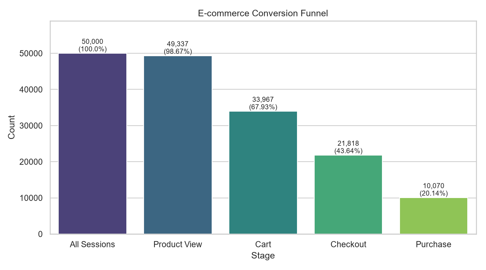
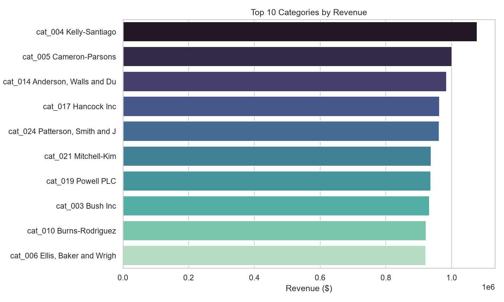
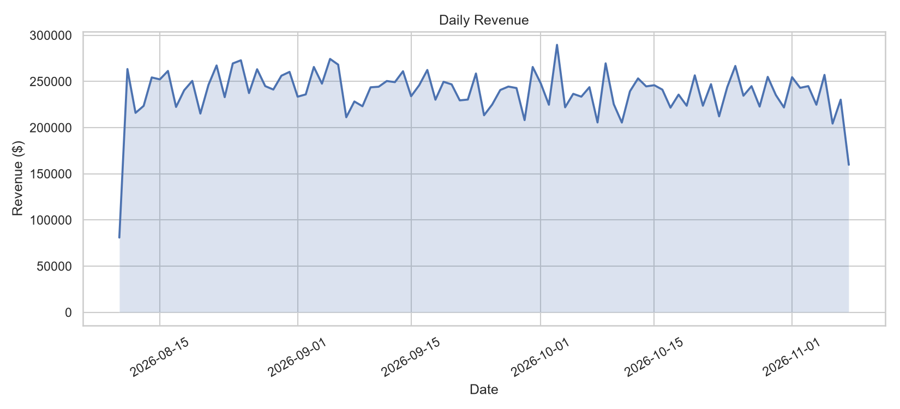
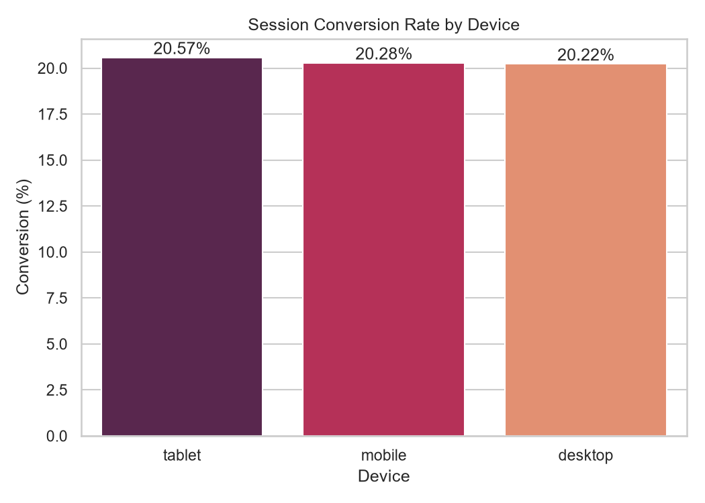
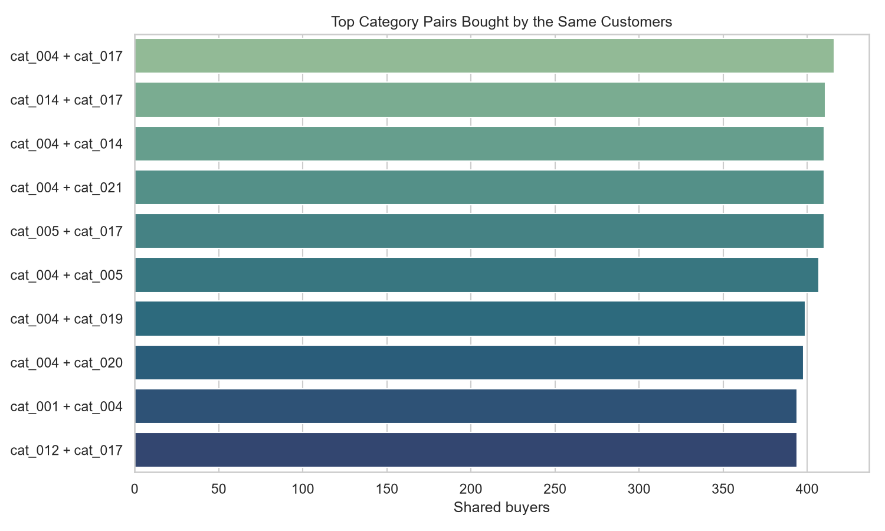

# E-Commerce Analytics: MongoDB, HBase and Apache Spark

An end-to-end data engineering project for a synthetic e-commerce platform. It generates 10,000 users, 5,000 products, 25 categories, 20,000 transactions and 50,000 browsing sessions, stores them in **MongoDB** and **HBase**, analyses them with **Apache Spark**, combines MongoDB and Spark in a **conversion funnel**, and visualises the results.

**Author:** samantha-umwali
**Full write-up:** [Technical report (PDF)](report/technical_report.pdf) | [Technical report (Markdown)](report/technical_report.md)

## What the project does

| Stage | Technology | What it produces |
|---|---|---|
| Data generation | Python, Faker | Users, products, categories, transactions and sessions as JSON |
| Document storage | MongoDB | Collections with indexes, plus aggregation queries (top products, revenue) |
| Wide-column storage | HBase | `user_sessions` table with a reverse-timestamp row key for "latest sessions of a user" |
| Processing | Apache Spark (PySpark) | Cleaned Parquet tables, "bought X also bought Y" recommendations, SQL analytics |
| Integration | MongoDB + Spark | Conversion funnel: sessions, product view, cart, checkout, purchase |
| Visualisation | Matplotlib, Seaborn | 5 charts built from the Spark results |

## Project structure

```
ecommerce-analytics/
├── dataset_generator_fixed.py   # generates the synthetic dataset
├── mongodb/
│   ├── load_data.py             # loads the JSON files into MongoDB
│   ├── load_and_index.py        # creates indexes and prints collection counts
│   └── aggregations.py          # aggregation pipelines
├── hbase/
│   ├── schema.txt               # HBase shell commands that create the tables
│   ├── load_sessions.py         # loads sessions into HBase
│   └── query_user.py            # prefix scan of one user's sessions
├── spark/
│   ├── clean_data.py            # raw JSON -> Parquet tables
│   ├── recs.py                  # product and category recommendations
│   └── sql_analytics.py         # Spark SQL queries -> CSV
├── integration/
│   └── funnel.py                # MongoDB purchases + Spark sessions -> funnel
├── visualizations/              # CSV results, charts and make_charts.py
└── report/                      # technical report (.md and .pdf), charts, screenshots
```

The `data/` folder (generated JSON and Parquet files) is not stored in Git because it is large and can be regenerated.

## Requirements

- Windows with PowerShell and Docker Desktop (about 4 GB of memory for Docker)
- Python 3.11 or newer
- Java 11 or 17 (needed by PySpark)

## Setup

Run all commands from the project folder in PowerShell.

```powershell
python -m venv venv
venv\Scripts\Activate.ps1
pip install faker pandas numpy pyspark pymongo happybase matplotlib seaborn
```

Start MongoDB and HBase:

```powershell
docker run -d --name mongo -p 27017:27017 mongo:latest
docker run -d --name hbase -h hbase -p 2181:2181 -p 9090:9090 -p 16000:16000 -p 16010:16010 -p 16201:16201 harisekhon/hbase
```

Wait about 90 seconds for HBase to start, then check the Master page at http://localhost:16010.

## How to run

**1. Generate the data**

```powershell
python dataset_generator_fixed.py
mkdir data -ErrorAction SilentlyContinue
move users.json, products.json, categories.json, transactions.json, sessions_*.json data\
```

**2. MongoDB**

```powershell
python mongodb\load_data.py
python mongodb\load_and_index.py
python mongodb\aggregations.py
```

**3. HBase**

Create the tables in the HBase shell (the commands are also in `hbase\schema.txt`):

```powershell
docker exec -it hbase hbase shell
```
```ruby
create 'user_sessions', 'meta', 'activity'
create 'product_metrics', 'daily'
list
exit
```

Then load and query the sessions:

```powershell
python hbase\load_sessions.py
python hbase\query_user.py
```

**4. Spark**

```powershell
python spark\clean_data.py
python spark\recs.py
python spark\sql_analytics.py
```

**5. Integrated funnel and charts**

```powershell
python integration\funnel.py
python visualizations\make_charts.py
```

**6. Optional: rebuild the PDF report**

```powershell
pip install markdown-pdf
python report\convert_to_pdf.py
```

## Design highlights

- **MongoDB:** transaction line items are embedded in each transaction document. Indexes on `user_id`, `items.product_id` and `category_id` support the main access paths.
- **HBase row key:** `user_id + "_" + (2^63 - 1 - epoch_seconds)`. The user prefix keeps one user's sessions together, and the reverse timestamp puts the newest sessions first.
- **Spark:** sessions are read with an explicit schema, because `cart_contents` is keyed by product id and schema inference would create thousands of columns. Transaction items are exploded into their own `transaction_items` table.
- **Funnel:** each stage requires the previous one. The purchase stage uses real purchases from MongoDB, not the session `conversion_status` flag.

## Results

### Conversion funnel


### Revenue by category


### Daily revenue


### Conversion rate by device


### Top category pairs bought together


## Troubleshooting

| Problem | Fix |
|---|---|
| MongoDB counts are `0` | Make sure the JSON files are in `data\` and run `mongodb\load_data.py` |
| HBase shell says `NoNode for /hbase/master` | Recreate the container with the `docker run` command above and wait 90 seconds |
| Spark `OutOfMemoryError` | Use the explicit schema in `clean_data.py` and keep `spark.driver.memory` at 4g |
| `No module named 'distutils'` | Do not use `toPandas()` on newer Python versions; the scripts here write CSVs without it |
| `winutils.exe` warning | Harmless in Spark local mode on Windows |
