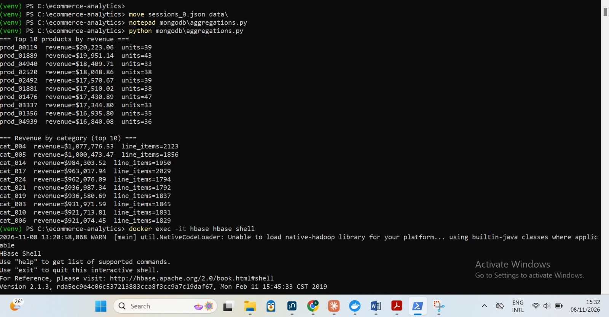
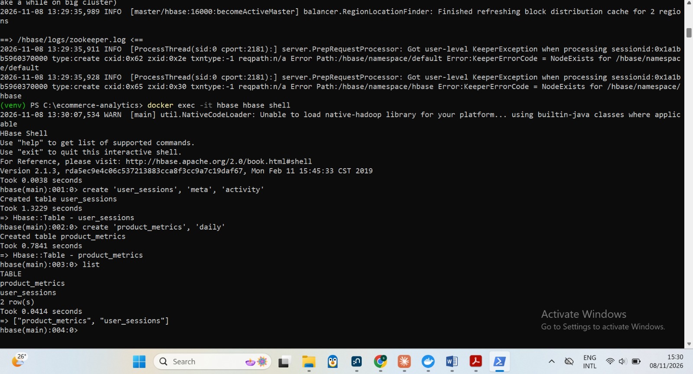
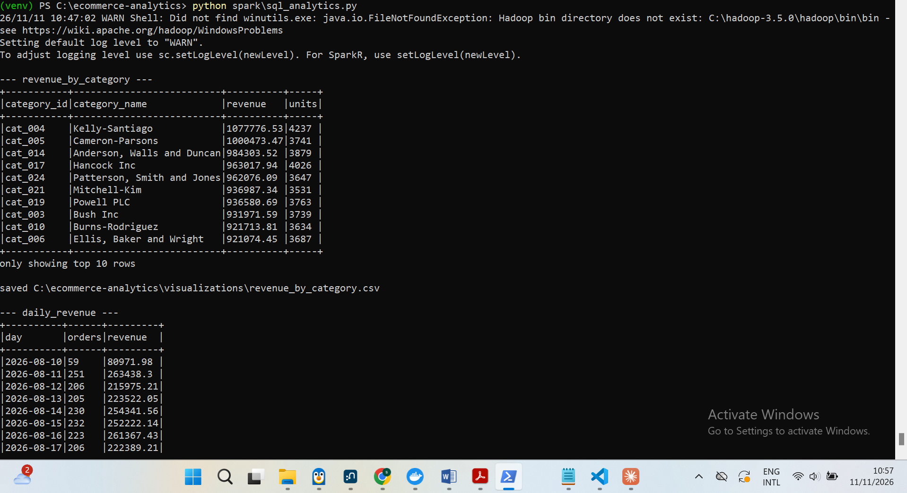
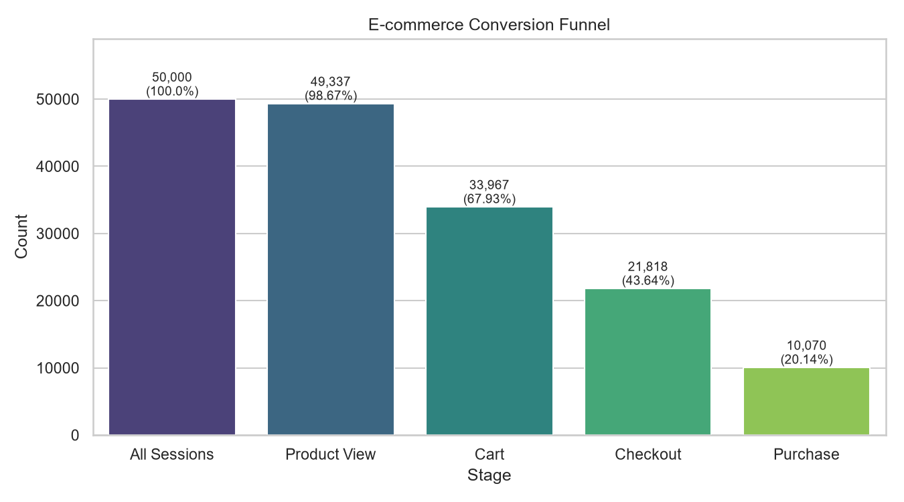
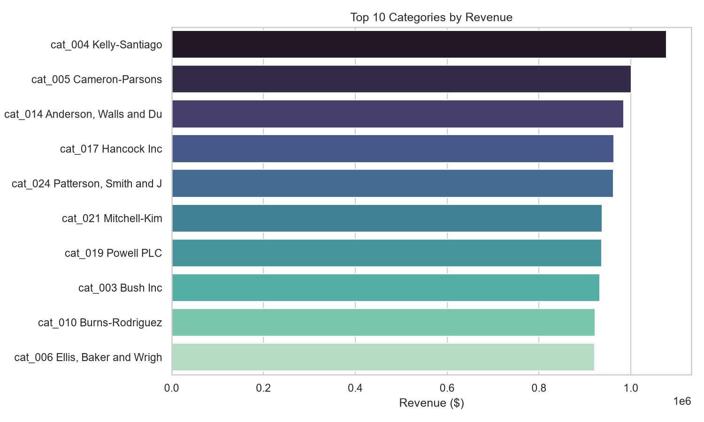
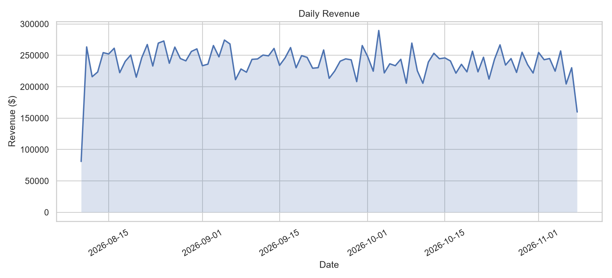
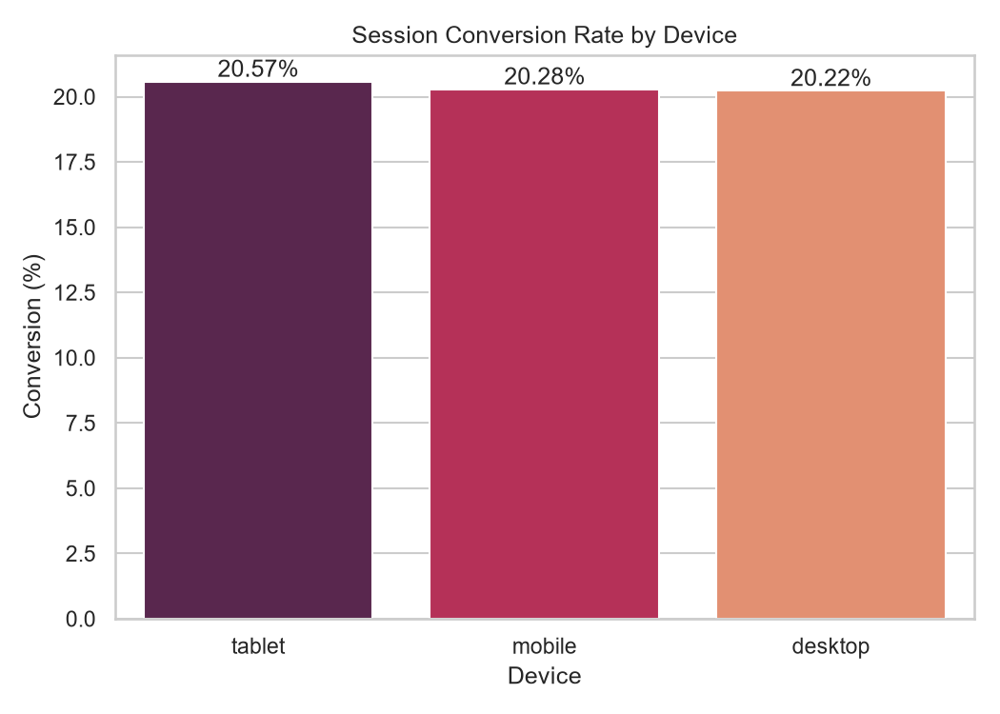
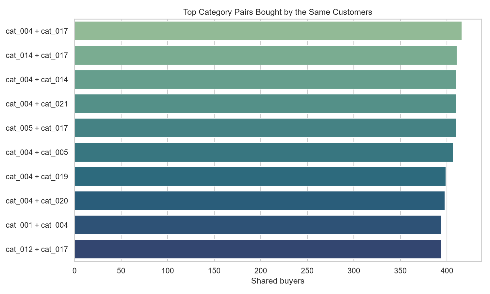

# E-Commerce Analytics Pipeline: Technical Report

**Author:** Samantha Umwali
**GitHub Repository:** https://github.com/samantha-umwali/ecommerce-analytics
**Date:** November 2026

## 1. Executive Summary
This report describes the implementation of an end-to-end data engineering pipeline for an e-commerce platform. The project covers synthetic data generation, NoSQL storage (MongoDB and HBase), distributed processing (Apache Spark), an integrated conversion-funnel analysis that combines MongoDB and Spark, and data visualizations. The generated dataset contains **10,000 users, 5,000 products, 25 categories, 20,000 transactions and 50,000 browsing sessions**.

## 2. Architecture & Technology Stack
- **Data Generation:** Python (`Faker`, `pandas`)
- **Document Database:** MongoDB (Docker)
- **Wide-Column Store:** Apache HBase (Docker, accessed through HappyBase and the Thrift server)
- **Distributed Processing:** Apache Spark (PySpark, local mode)
- **Visualization:** Matplotlib, Seaborn

```
Generator (JSON files)
   |-- MongoDB  : users, products, transactions   --> aggregations
   |-- HBase    : user_sessions, product_metrics  --> row-key scans
   |-- Spark    : Parquet tables --> recommendations, SQL analytics
                         |
         MongoDB purchases + Spark sessions --> conversion funnel
                         |
                CSV files --> 5 charts --> this report
```

## 3. Data Generation
The dataset was generated with a custom Python script (`dataset_generator_fixed.py`).
- **Configurations used:** `NUM_TRANSACTIONS = 20000`, `NUM_SESSIONS = 50000`.
- **Output:** `users.json`, `products.json`, `categories.json`, `transactions.json` and `sessions_0.json` (about 94 MB), all stored in the `data/` folder.
- **Data shape:** the data is nested and semi-structured. Transactions contain an `items` array, sessions contain `page_views`, `viewed_products` and a `cart_contents` object, and products contain a `price_history` array.
- **Challenge Resolved:** the generator was supplied inside a notebook-style document, so the code was extracted into a standalone `.py` file before it could run. The script also saves its JSON files in the folder it is run from, so the files had to be moved into `data/`.

## 4. MongoDB Implementation
MongoDB was used to store the user, product and transaction documents in the `ecommerce` database.
- **Loading:** the data was loaded into the `users`, `products`, `categories` and `transactions` collections. The final counts were 10,000 users, 5,000 products, 25 categories and 20,000 transactions.
- **Challenge Resolved:** the first import with `docker cp` and `mongoimport` reported zero documents, and the index script printed `counts: 0 0 0`. The cause was that the JSON files were not in the `data/` folder and the index script only created indexes without loading anything. A Python loader using PyMongo (`insert_many` in batches of 5,000) was written. It finds each file, loads it and prints a count check.
- **Indexes Created:**
  - `transactions`: `user_id`, `items.product_id`
  - `products`: `category_id`
- **Aggregations Performed:**
  1. **Top products by revenue:** `$unwind` on the `items` array, `$group` by `product_id` summing the line subtotal and quantity, then `$sort` and `$limit`.
  2. **Revenue by category:** `$unwind` on `items`, `$lookup` into `products` to get the category, then `$group` by `category_id`.

### MongoDB Aggregations
###


## 5. HBase Implementation
HBase was used to store user session activity.
- **Schema Created:**
  - `user_sessions` (families: `meta`, `activity`)
  - `product_metrics` (family: `daily`)
- **Row key design:** `user_id + "_" + (2^63 - 1 - epoch_seconds)`. The user id prefix keeps all sessions of one user together, and the reverse timestamp puts the newest sessions first, so "latest sessions of a user" is a short prefix scan.
- **Data Loading:** a HappyBase Python script batch-inserted the sessions with `table.batch()`. The `meta` family holds device, location and referrer details. The `activity` family holds duration, conversion status, page-view count and cart contents.
- **Query:** a second script retrieves one user's sessions with `table.scan(row_prefix=...)`. The same query was demonstrated in the HBase shell with `ROWPREFIXFILTER`.
- **Challenge Resolved:** the HBase shell returned `KeeperErrorCode = NoNode for /hbase/master`. The logs showed the region server had shut down after its ZooKeeper session expired, so the Master was no longer running even though the container showed as "Up". The container was recreated with a fixed hostname and explicit port mappings, and the startup was given 60 to 90 seconds to finish.

### HBase Tables



## 6. Spark Data Processing & Analytics
Spark (local mode, 4 GB driver memory) was used for cleaning, recommendations and SQL analytics.
- **Data Cleaning:** null `user_id` records and duplicate ids were dropped, timestamps were cast, and nested fields (`geo_data`, `device_profile`) were flattened. The data was saved in Parquet format as six tables: `users`, `products`, `categories`, `transactions`, `transaction_items` and `sessions`. Each transaction's `items` array was exploded into the `transaction_items` table (one row per purchased product). Session flags (`viewed_product`, `reached_cart`, `reached_checkout`) were derived from the `page_views` array.
- **Recommendations:** a self-join was used to calculate "bought X also bought Y" co-occurrences, at product level (same transaction) and at category level (same customer). Random synthetic data rarely repeats the same product pair, so the category-level result gives the clearer signal.
- **SQL Analytics:** Spark SQL queries on temporary views produced revenue by category, daily revenue, conversion rate by device and revenue by country:

```sql
SELECT p.category_id, c.category_name,
       ROUND(SUM(ti.line_total), 2) AS revenue, SUM(ti.quantity) AS units
FROM txn_items ti
JOIN prod p ON ti.product_id = p.product_id
JOIN cat  c ON p.category_id = c.category_id
GROUP BY p.category_id, c.category_name
ORDER BY revenue DESC
```

- **Challenges Resolved:**
  - `OutOfMemoryError: Java heap space`: schema inference on `cart_contents` (keyed by product id) created thousands of columns. This was fixed with an explicit session schema and `spark.driver.memory` set to 4 GB.
  - `UNRESOLVED_COLUMN ... items`: after the items were exploded, the `transactions` table no longer had an `items` column. The queries were rewritten to use `transaction_items`, which also corrected the revenue-by-category logic so that every line item is counted.
  - `No module named 'distutils'`: caused by `toPandas()` on newer Python versions. It was replaced by a collect-based CSV writer for small result sets.
  - The `winutils.exe` warning appears in Windows local mode and does not affect the results.

### Spark SQL Output



## 7. Integration: E-Commerce Funnel
The funnel analysis combines MongoDB and Spark. MongoDB supplies the `session_id` values of sessions that ended in a purchase, and Spark supplies what each session did.
- **Stages** (each stage requires the previous one, so the funnel can only narrow):
  1. **All Sessions:** every session.
  2. **Product View:** the session viewed a product page.
  3. **Cart:** the session also visited the cart page.
  4. **Checkout:** the session also visited the checkout page.
  5. **Purchase:** the session also has a matching transaction in MongoDB.
- **Output:** `visualizations/funnel.csv` with the count and percentage at each stage.
- **Challenges Resolved:**
  - The first version used `cart_contents IS NOT NULL` for the cart stage, which counted every session because the field is always present (empty when nothing was added). It also searched for a `purchase` status that does not exist, because the values are `converted`, `abandoned` and `browsed`. The funnel was rebuilt from page-view flags plus real purchases from MongoDB.
  - `PicklingError / RecursionError` came from `spark.createDataFrame()` on a Python list. The five result rows are now written directly with pandas.
  - `Python worker failed to connect back` was fixed by setting `PYSPARK_PYTHON` to the virtual environment's Python.

## 8. Visualizations
The results were visualized with Matplotlib and Seaborn. The Spark jobs write their results to CSV files, and `visualizations/make_charts.py` turns them into five charts.

### 8.1 Funnel Analysis



The funnel narrows at every stage, which is expected because each stage requires the previous one. Almost every session views a product, and the largest losses happen between viewing a product and completing a purchase, which is where the platform loses most potential customers.

### 8.2 Revenue by Category



The chart ranks the top 10 categories by revenue, calculated from every purchased line item. It shows which categories contribute most to sales, which is useful for stock planning and promotions.

### 8.3 Daily Revenue Trend



Daily revenue over the 90-day period fluctuates around a stable level without a strong upward or downward trend. This is typical of randomly generated data, whereas real data would usually show weekly patterns or seasonal peaks.

### 8.4 Conversion Rate by Device



The conversion rate is very similar for desktop, mobile and tablet sessions, so no device type clearly outperforms the others. In real traffic this chart would normally reveal device-specific problems.

### 8.5 Product Recommendations



The chart shows the category pairs most often bought by the same customers. The counts are close to each other, which means no single pair dominates. These pairs can be used as "customers who bought from category A also bought from category B" suggestions.

## 9. Conclusion & Environment Challenges
The pipeline successfully demonstrated the integration of MongoDB, HBase and Spark: documents were stored and aggregated in MongoDB, session activity was modelled for fast key-based access in HBase, and Spark cleaned the data, produced recommendations and SQL analytics, and joined everything with MongoDB purchase data to build the conversion funnel. Several environment challenges were encountered and resolved:

1.  **Data Loading:** the MongoDB import returned zero documents because the files were in the wrong folder and the index script did not load data. A PyMongo loader replaced it.
2.  **HBase Stability:** the Master stopped after the ZooKeeper session expired. Recreating the container with a fixed hostname and explicit ports fixed it, and disabling sleep prevents a repeat.
3.  **Spark Memory:** schema inference on `cart_contents` caused `OutOfMemoryError`. An explicit schema and 4 GB of driver memory solved it.
4.  **Python and PySpark Compatibility:** `toPandas()` and `createDataFrame()` failed on newer Python versions. Both were replaced with simpler, version-independent code.
5.  **Query Logic:** the original queries assumed an `items` column that no longer existed after cleaning, and the original funnel stages were not meaningful. Both were corrected using the `transaction_items` table and page-view flags.

**Note:** the data is synthetic and everything ran on a single machine, so results show the pipeline's design rather than real-world scale.